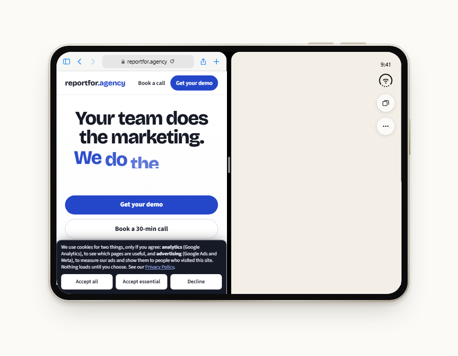
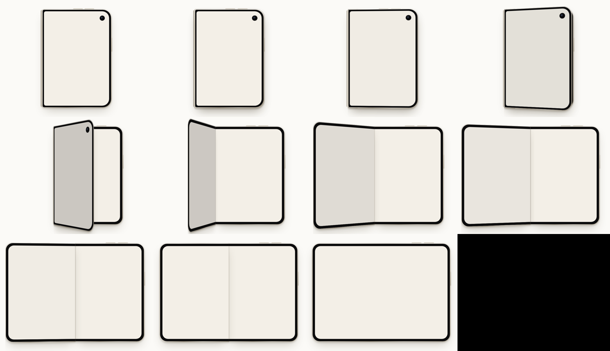

<div align="center">

# iPhone Duo Preview

**See how any website renders on iPhone Duo, at real size, folded and unfolded.**

[**Live demo →**](https://iphone-duo-preview-eight.vercel.app) &nbsp;·&nbsp; [How it works](#how-it-works) &nbsp;·&nbsp; [Display specs](#display-specs) &nbsp;·&nbsp; [Run locally](#run-locally)


</div>

---

Type a URL into the address bar. The page loads inside a true-to-scale iPhone Duo with an iPhone Safari user agent, and you can fold, unfold and turn the phone to see where your layout holds up and where it breaks.

## Features

- **Real dimensions.** Every screen is drawn from Apple's published pixel counts and the device's millimetre size, so a page gets exactly the viewport it would get on the phone. No responsive guesswork.
- **Fold and unfold.** Click the phone or the **Unfold** button. The cover half swings open on its hinge in 3D, timed to Apple's own unfold footage.
- **Five display modes:** Folded (cover screen), Landscape, Portrait, Seated (half-folded, top half only) and Split View.
- **Website or native app.** Switch between a page opened in **Safari** (right-edge status rail plus the Safari toolbar) and a **native app** that goes full screen under iOS 27's floating × / ⤢ ⋯ window controls.
- **Tells the site it's an iPhone.** Pages are fetched with an iOS Safari user agent, and `navigator.userAgent`, `platform`, touch support, `screen` size, `devicePixelRatio` and `(pointer: coarse)` all report an iPhone.
- **Behaves like real Safari.** Pages without a `<meta name="viewport">` are laid out 980 px wide and shrunk to fit, just as on a real iPhone.
- **Preloads every mode.** The view you're on loads first; the other four load in the background, so unfolding is instant.
- **Test report.** One panel shows, per mode: screen size, viewport, and whether the page fits, overflows sideways (by how many px), or isn't mobile-ready.

## Screenshots

| Folded · cover screen | Split View |
|:---:|:---:|
|  |  |
| **Native app · full screen** | **Portrait** |
|  |  |

<details>
<summary><b>Unfold sequence</b></summary>
<br>

</details>

## Display specs

Screen sizes are in iOS points (CSS px). All displays are @3x.

| Mode | Screen (pt) | Pixels | Website (Safari) | Native app |
|---|---|---|---|---|
| Folded · cover | 466 × 678 | 1398 × 2034 · 460 ppi | 386 × 604 | 386 × 678 |
| Landscape | 890 × 626 | 2670 × 1878 · 430 ppi | 810 × 576 | 890 × 626 |
| Portrait | 626 × 890 | 1878 × 2670 | 546 × 840 | 626 × 890 |
| Seated (top half) | 626 × 445 | 1878 × 1335 | 546 × 395 | 626 × 445 |
| Split View (one pane) | 439 × 626 | ~1317 × 1878 | 439 × 576 | 439 × 626 |

- **Body:** 164.6 × 117.8 mm open (5.2 mm thick); about 84 × 118 mm folded (11.3 mm).
- **Displays:** inner 7.58″, cover 5.36″ (Apple's rectangle measurements). Both are about 1 : 1.42–1.45.
- **iOS 27 on Duo** has no top status bar and no home indicator. Time and Wi-Fi live in an ~80 pt rail on the right edge, under the cover camera. Full-screen apps get a floating top row instead.

> [!NOTE]
> Apple publishes pixel resolutions, not point sizes. The point sizes above are pixels ÷ 3, and Safari's toolbar heights on the Duo are estimates. Expect small differences on the real device.

## How it works

```
 browser ──► index.html + app.js          device drawn in CSS from mm geometry,
                │                          one <iframe> per display mode
                ▼
         /api/proxy?url=…  (Vercel function)
                │  fetch with iPhone Safari UA, follow redirects safely
                │  strip X-Frame-Options / CSP so the page can be framed
                │  inject <base> + a shim (UA, touch, screen, DPR, pointer)
                ▼
         page reports its layout back with postMessage → test report
```

| Path | What it does |
|---|---|
| [`site/index.html`](site/index.html), [`site/app.css`](site/app.css) | Page shell, address bar, dock, device styling |
| [`site/app.js`](site/app.js) | Device geometry (`MODES`), the 3D hinge animation (`buildRig`, `swing`), mode transitions, loading and the test report |
| [`site/api/proxy.js`](site/api/proxy.js) | Proxy plus the injected iPhone shim. Blocks private and internal addresses, follows at most 5 redirects, caps pages at 8 MB, 12 s timeout, rate-limits to 60 requests per minute per IP |
| [`tools/whiten-frames.js`](tools/whiten-frames.js) | Earlier experiment that painted the screens white in Apple's unfold video (frames are kept out of the repo) |
| [`vault/`](vault/) | Obsidian vault holding project notes and the session hand-off |

## Run locally

There's no build step. You need Node 18+ and the [Vercel CLI](https://vercel.com/docs/cli).

```bash
git clone https://github.com/zuhaibasad/iphone-duo-preview.git
cd iphone-duo-preview/site
vercel dev            # serves the page and /api/proxy on http://localhost:3000
```

Deploy with `vercel deploy --prod` from `site/`.

If you open `index.html` some other way (an editor preview, `file://`), the page falls back to the deployed proxy automatically.

## Limitations

- Some sites can't be fully emulated through a proxy:
  - pages behind a login, or that rely on cookies
  - pages that call their own APIs from the browser (CORS)
  - some single-page apps that route on `location.pathname`
- CSS `(pointer: coarse)` media queries inside stylesheets still see a desktop pointer. Only the JavaScript `matchMedia` call is patched.
- The proxy is public and only rate-limited. Put it behind auth before sharing widely.

## Credits

Device proportions and UI details were studied from Apple's and Anthropic's public imagery, which is not included in this repo. Specs come from [Apple Newsroom](https://www.apple.com/newsroom/2026/09/apple-unveils-iphone-duo/), [MacRumors](https://www.macrumors.com/roundup/iphone-duo/) and [codeconfig.dev](https://codeconfig.dev/blog/iphone-duo-screen-size).
